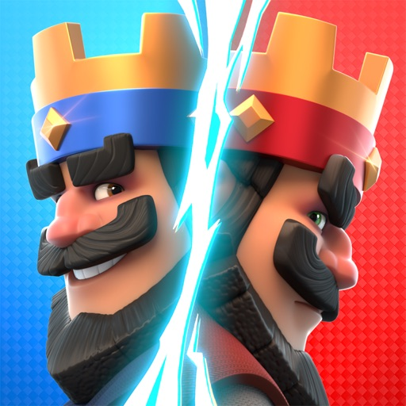
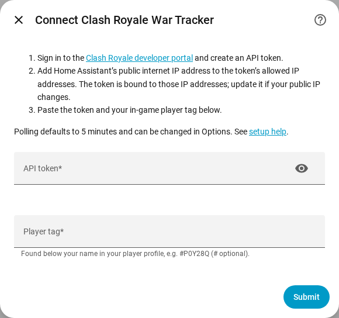

# Clash Royale War Tracker for Home Assistant

Player, current-clan and River Race sensors using Supercell's official API. Enter a player tag once; the integration follows that player's current clan automatically.

## Installation

Requires **Home Assistant Core 2026.11.0 or newer**.

1. Open **Settings → Marketplace → Add from link** and enter `https://github.com/ColeMundus/ha-clash-royale`. Connect GitHub if prompted.
2. Find **Clash Royale War Tracker**, choose **Install**, and restart Home Assistant when prompted. No pre-release setting is needed.
3. Open **Settings → Devices & services → Add integration → Clash Royale War Tracker**.

For HACS installations, add the URL under **Custom repositories** with category **Integration**.

This is a **custom HACS repository**; it has not been submitted to the default catalog.

**Manual install:** Download the [release ZIP](https://github.com/ColeMundus/ha-clash-royale/releases/download/v0.1.1/clash_royale_war-0.1.1.zip), extract it into your Home Assistant configuration directory, and restart.

## Create an API key

1. Sign in at the [Clash Royale developer portal](https://developer.clashroyale.com/).
2. Open **My Account → Create New Key** and enter a name and description.
3. Under **Allowed IP addresses**, enter the public IP address used by Home Assistant's outbound requests. Developer keys are IP-bound; update the key if that address changes.
4. Create the key, then paste its **Token** into the integration's **API token** field and enter your in-game **Player tag**.

Only the API token and player tag are required. Add another integration entry to monitor another player. Polling defaults to five minutes and is adjustable from 1–60 minutes through **Configure**.

## Sensors

| Group | Sensors |
| --- | --- |
| Player | Trophies, best trophies, XP level, XP points, wins, losses, battle count, donations, donations received |
| Current clan | Clan members, clan score, clan war trophies |
| Clan River Race | River race fame, River race repair points |
| Player River Race | Player race fame, player race repair points, player race boat attacks, player race decks used, player race decks used today |

Player race fame is the player's reported medals; clan River Race fame is clan progress or Colosseum score, not the sum of player medals. No race rank is exposed.

## Limitations

- Data is polled, not live. Players without a clan and missing optional River Race data leave the corresponding sensors unavailable, not zero.
- The API does not expose chest queues, upgrade timers or resource balances. Decks used today is a reported count, not a remaining-attacks estimate or a reset countdown.
